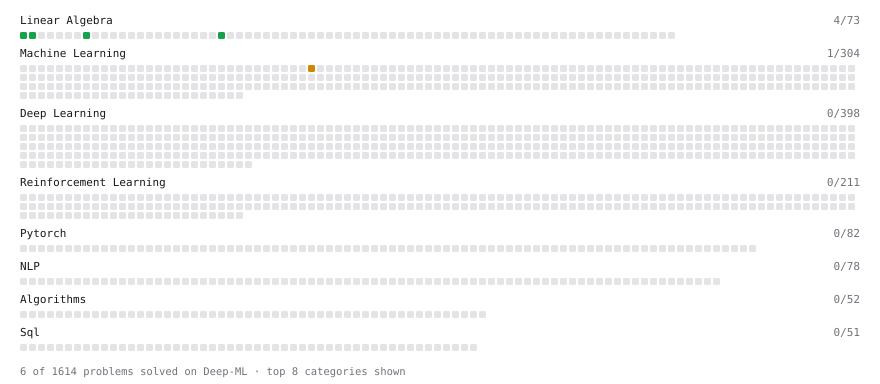

# Deep-ML

My machine learning practice from [Deep-ML](https://www.deep-ml.com). Every solution here was written by hand.

**14** solved · 9 problems · 0 labs · 5 math

[**Browse the interactive portfolio**](https://Samurai412.github.io/deep-ml/) to replay this filling in over time.

## Problems

| | Difficulty | Solved | |
| --- | --- | --- | --- |
| [Calculate 2x2 Matrix Inverse](https://www.deep-ml.com/problems/8) | easy | 2026-10-19 | [solution](problems/0008-calculate-2x2-matrix-inverse) |
| [Derivative of a Polynomial](https://www.deep-ml.com/problems/116) | easy | 2026-10-20 | [solution](problems/0116-derivative-of-a-polynomial) |
| [Gradient Direction and Magnitude](https://www.deep-ml.com/problems/308) | easy | 2026-10-20 | [solution](problems/0308-gradient-direction-and-magnitude) |
| [Implement Orthogonal Projection of a Vector onto a Line](https://www.deep-ml.com/problems/66) | easy | 2026-10-19 | [solution](problems/0066-implement-orthogonal-projection-of-a-vector-onto-a-line) |
| [Matrix-Vector Dot Product](https://www.deep-ml.com/problems/1) | easy | 2026-10-18 | [solution](problems/0001-matrix-vector-dot-product) |
| [Transpose of a Matrix](https://www.deep-ml.com/problems/2) | easy | 2026-10-18 | [solution](problems/0002-transpose-of-a-matrix) |
| [Chain Rule for Composite Functions](https://www.deep-ml.com/problems/214) | medium | 2026-10-20 | [solution](problems/0214-chain-rule-for-composite-functions) |
| [Linear Regression - Power Grid Optimization](https://www.deep-ml.com/problems/92) | medium | 2026-10-19 | [solution](problems/0092-linear-regression-power-grid-optimization) |
| [Partial Derivatives of Multivariable Functions](https://www.deep-ml.com/problems/215) | medium | 2026-10-20 | [solution](problems/0215-partial-derivatives-of-multivariable-functions) |

## Math

| | Difficulty | Solved | |
| --- | --- | --- | --- |
| [Derivatives and Gradients](https://www.deep-ml.com/math-problems/1) | easy | 2026-10-19 | [solution](math/0001-derivatives-and-gradients) |
| [Inverse and Rank](https://www.deep-ml.com/math-problems/12) | medium | 2026-10-19 | [solution](math/0012-inverse-and-rank) |
| [Least Squares and the Normal Equations](https://www.deep-ml.com/math-problems/34) | medium | 2026-10-19 | [solution](math/0034-least-squares-and-the-normal-equations) |
| [Multivariate Calculus](https://www.deep-ml.com/math-problems/2) | medium | 2026-10-20 | [solution](math/0002-multivariate-calculus) |
| [Orthogonality and Projections](https://www.deep-ml.com/math-problems/14) | medium | 2026-10-19 | [solution](math/0014-orthogonality-and-projections) |

---

_This file is regenerated by Deep-ML on every push._
